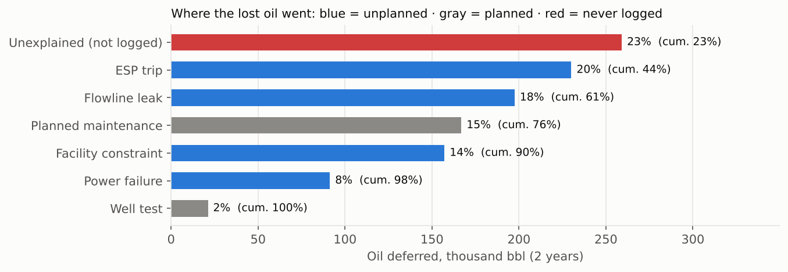
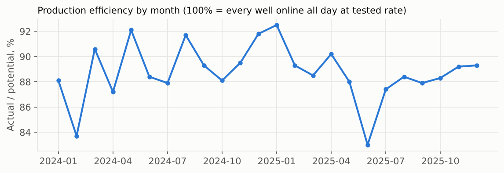
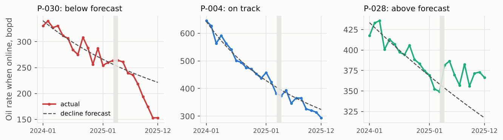
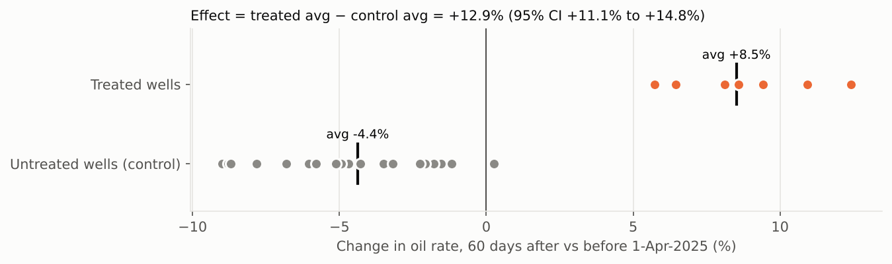

# Production Deferment & Well Performance Analytics (SQL + Python)

**Where is our oil being lost, which wells need attention, and did our well treatment actually work?**
A production-analytics project on 2 years of daily data from 30 oil wells: messy daily production reports
and operator downtime logs are cleaned and analysed **in SQL**, then **Python statistics** add
decline-curve forecasting and a proper treatment-effect test.

> Portfolio project for a Data Scientist role in the energy sector. Data is synthetic (no confidential data)
> but reproduces real reporting problems. Companion project to *ESP Failure Early-Warning* (ML).

---

## Findings (from `reports/production_review.html`)

| Finding | Number |
|---|---|
| Production efficiency (actual ÷ potential) | **88.8%** |
| Oil deferred over 2 years | **1.12 million bbl** (≈ $79M at $70/bbl) |
| Biggest explained cause | **ESP trips**, 20.5% of lost oil |
| Lost oil with **no reason in the operator log** | **23%** (166 events): cheapest fix is logging discipline |
| Wells found *below* their decline forecast | **3**, the same 3 wells with a hidden developing problem (3 of 3 found, 0 false flags) |
| Scale-squeeze treatment effect (difference-in-differences) | **+12.9%** (95% CI +11.1% to +14.8%; true value built into the data = 12%) |
| Same effect measured naively (before vs after) | +8.5%, **under-states the effect** because it ignores natural decline |

**Where the lost oil went.** The biggest single bucket is oil lost with no reason in the operator log.



**Production efficiency by month** (actual ÷ potential), between 83% and 92% over the two years.



**Decline-curve check.** Each well is compared with its own forecast: P-030 is falling below it (investigate),
P-028 is running above it (update the forecast).



**Did the scale-squeeze treatment work?** Treated wells rose 8.5% while untreated wells fell 4.4% over the
same period, so the real effect is +12.9%, not the naive +8.5%.



---

## SQL skills shown (`sql/`)

| Technique | Where | Business use |
|---|---|---|
| Layered warehouse (raw → clean), never editing raw | `01_schema.sql`, `02_clean.sql` | Auditable cleaning |
| `ROW_NUMBER()` de-duplication | `02_clean.sql` | Remove duplicate daily reports |
| `CASE` + `LIKE` text standardisation | `02_clean.sql` | 21 free-text reasons → 6 standard causes |
| `WITH RECURSIVE` calendar spine + `CROSS JOIN` / `LEFT JOIN` | `02_clean.sql` | Make *missing* reports visible |
| "As-of" join (latest test on/before a date) | `02_clean.sql` | Daily production potential |
| SQL data tests (must return 0 rows) | `03_quality_checks.sql` | Pipeline stops on bad data |
| **Gaps-and-islands** (`date − ROW_NUMBER()`) | `04_analysis.sql` | Collapse down-days into downtime events |
| Interval-overlap join | `04_analysis.sql` | Attribute events to log entries; find unlogged ones |
| Running total `SUM() OVER (ORDER BY …)` | `04_analysis.sql` | Pareto cumulative % |
| `LAG()`, `RANK()`, `NTILE()`, `PARTITION BY` | `04_analysis.sql` | Month-over-month change, well ranking, quartiles, share of field |
| `FIRST_VALUE` / `LAST_VALUE` with a named `WINDOW` | `04_analysis.sql` | Water-cut trend per well |
| Exposure-based rate (`NULLIF` safe division) | `04_analysis.sql` | Mean days between failures by lift type |

## Python / statistics shown (`src/`)
* **Arps hyperbolic decline-curve fitting** (`scipy.optimize.curve_fit`), rate normalised for downtime,
  fitted on history and checked against later actuals (median R² 0.90, median error 5%).
* **Difference-in-differences** with a control group, **Welch t-test**, **Mann-Whitney U** and a **bootstrap 95% CI**.
* Plain-language HTML report for management (`src/report.py`).

## Run it
```bash
pip install -r requirements.txt
make all     # python -m src.pipeline  (~10 s)
make test    # 12 tests: each SQL rule on tiny known inputs + pipeline vs ground truth
```

## Layout
```
sql/01_schema.sql           raw tables
sql/02_clean.sql            cleaning rules, calendar spine, potential & deferment
sql/03_quality_checks.sql   SQL data tests
sql/04_analysis.sql         7 named analysis queries -> reports/sql/*.csv
src/run_sql.py              loads CSVs, runs SQL in order, enforces data tests
src/decline.py              decline-curve forecasts and under-performer flags
src/intervention.py         treatment-effect test
src/report.py               management report
docs/                       SQL walkthrough, CV and interview kit
docs/images/                result charts shown in this README (from the management report)
```
